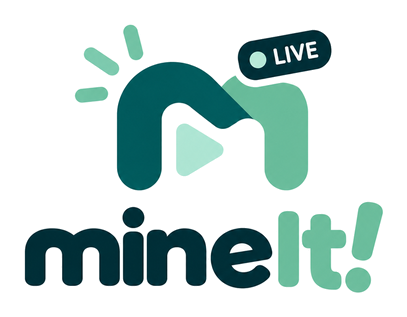
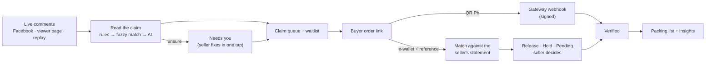

<p align="center">
  
</p>

<h3 align="center">From “mine!” to paid and packed.</h3>

<p align="center">
  The order desk for Filipino Facebook Live sellers. It turns live comments into claimed, paid and packed orders,<br>
  and checks every payment before anything ships.
</p>

<p align="center">
  <sub>Built for CSSprint 2026, the UST Computer Science Society hackathon · working prototype</sub>
</p>

---

## The problem

> “Develop practical and digital solution that address a specific problem faced by Filipino MSME’s.”
> CSSprint 2026, revealed on Day 1 (October 22, 2026)

Filipino MSMEs that sell through Facebook Live lose money between the comment and the delivery. During a live, comments fly by: “mine B12”, “ate yung blue polo po”, “cancel ko na B3”. The seller has to catch every claim, remember who was first and who is next in line, all while talking to the camera. After the live the real work starts:

- Buyers send screenshots as proof of payment, and the seller checks each one against her GCash or bank app by hand.
- Some screenshots are fake. If she misses one, she ships an item she was never paid for.
- Some buyers claim and never pay (“joy reservers”), so the item is stuck instead of going to the next buyer.

**Meet Jessa.** She runs an ukay business in Tondo and goes live three times a week with 40 to 80 items per live. She captures orders by scrolling through comments and writing them in a notebook. Checking payments takes her hours after every live, and she has been burned by fake receipts before. Jessa is the demo shop in this prototype.

**Why it matters**
- MSMEs are 99.63% of all enterprises in the Philippines, and 90.43% are micro. ([DTI, from PSA 2023 data](https://dti.gov.ph/businesses/msmes/msmeresources/msme-statistics))
- Meta ended its official live shopping features, but sellers kept selling through comments, so orders are still captured by hand. ([GMA News, 2022](https://gmanetwork.com/news/money/companies/841010/users-in-philippines-may-still-do-facebook-live-selling-meta/story))
- Fake payment proofs cost real money: police arrested a bogus buyer who bought almost ₱230,000 worth of clothing online. ([DZRH](https://dzrh.com.ph/post/pnp-arrest-a-bogus-buyer-who-purchase-almost-p230000-worth-of-clothing-online))

## What mineIt! does

**1. Captures orders during the live**
- Reads comments from a Facebook Live, from the in-app live page (viewers scan a QR, watch the seller’s camera on their phone and comment), or from a replayed recording.
- Turns comments into orders in real time. “Mine B12” claims B12 for the first commenter; the next one joins a waitlist and moves up if the first cancels or doesn’t pay.
- Comments it isn’t sure about go to a **Needs you** list for a one-tap fix, instead of becoming a wrong order.

**2. Checks payments before shipping**
- Each buyer gets a private order link to confirm size and quantity and then pay, by **QR Ph** (verified in seconds) or by sending money to the seller’s e-wallet and typing the reference.
- References and amounts are checked against the seller’s own statement and come back as **Release**, **Hold** (with every reason) or **Pending**. The seller makes the final call in one tap.

**3. Packs with confidence**
- A packing list of verified orders only, grouped by buyer.
- Insights for every live, and buyer records (Hold / Watch / Trusted / New) so repeat non-payers are easy to spot.

## Run it (2 minutes)

Needs Python 3.12+ and Node 20+. No accounts, API keys or database server.

```powershell
./start-demo.ps1          # Windows
./start-demo.sh           # macOS / Linux
```

Open **http://localhost:8000/seller** and enter the seller key `demo-seller-key`. Phones on the same Wi-Fi can scan the QR codes straight from the laptop, which prints its LAN address in them. Development mode, Supabase and deployment are in [docs/08](docs/08-setup-run-deploy.md).

## Try the whole flow in 3 minutes

1. **Go live → Live here → Start live.** Click **Turn on camera**, then tap **B12** to put it on camera.
2. Scan **Scan to join** with a phone, enter a name and comment `mine`. The claim appears on the board within a second and the phone gets an order link.
3. On the phone, open the order, pick a size and **Confirm order**, then **Pay with QR Ph → Pay on this phone instead → Confirm payment**. The order page flips to *Payment confirmed* and the order shows up on **Packing**.
4. For the manual path, a second buyer taps **I paid via GCash**, sends money in DemoWallet and types the reference. A third types a made-up reference. On **Payments**, tap **Get DemoWallet statement** and upload it: the real one turns **Release**, the fake one **Hold: reference not in your statement**.

The 5-minute pitch script, with fallbacks for bad Wi-Fi, is in [docs/10](docs/10-demo-script.md).

## What is real and what is simulated

Every screen carries a **Prototype demo** marker, and **What’s real?** opens this list in the app.

| Real | Simulated |
| --- | --- |
| Comments becoming orders as they arrive | QR Ph payments go through **MockPay**, a test gateway; no real money moves |
| The seller’s camera streaming to viewers’ phones (WebRTC) | **DemoWallet** stands in for GCash or Maya and produces the statement the seller uploads |
| The first-come queue, waitlist, expiry timers and every payment check | The shop, catalog and past lives are sample data; **Settings → Reset demo data** restores them |

MockPay follows the shape of a real QR Ph gateway (payment intent, QR, signed `payment.paid` webhook), so a real provider such as PayMongo would slot into the same flow.

## How it works



**Where AI fits, and why.** Rules first, AI only where rules fail. “mine B12” is plain regex. “mine blu polo” is caught by fuzzy matching against the catalog. Only messy Taglish that both miss goes to a language model, which may answer with one of the item codes it was offered and nothing else. If the model is unsure or unavailable, the comment goes to **Needs you**. Every money decision (the queue, the payment match, Release or Hold) is plain logic, not AI, so it is predictable and easy to explain.

Measured on a starter set of 69 labeled Taglish comments ([api/bench](api/bench)):

| Setup | Read correctly | Wrong orders |
| --- | --- | --- |
| Rules only | 58.0% | 0% |
| Rules + fuzzy matching | 94.2% | 0% |

The AI step is built but has not been run live because no OpenRouter key was available; add one to `api/.env` and run `python -m bench.run_bench` to add its rows.

**Payments.** Manual mode works for any seller with no setup: the buyer self-checks in their own wallet app, submits the reference, and the system matches it against the seller’s statement. Instant mode uses a QR Ph code and a signed webhook. Details: [docs/05](docs/05-payments-and-mock-qrph.md).

## Privacy and trust

- Facebook comments are read through Meta’s official Live Video API, read-only, with the seller’s permission. No scraping and nothing posted on the seller’s behalf.
- Buyer names are masked on shared or projected screens (“Mark D.”).
- The AI sees the comment text, the catalog’s item codes and names, and the buyer’s recent item codes, never their name or Facebook id, and the app never asks for a buyer’s account number.
- Each seller’s buyer records stay in her own shop; there is no shared blacklist.
- Built with the Data Privacy Act of 2012 (RA 10173) in mind, including **Delete data** for any buyer. See [docs/12](docs/12-security-privacy-limits.md).

## Tech stack

FastAPI · SQLAlchemy 2 (SQLite locally, PostgreSQL/Supabase in production) · RapidFuzz · httpx · Pydantic · OpenRouter · Meta Live Video API · Server-Sent Events · WebRTC · React 19 + Vite + TypeScript · Tailwind CSS 4 · React Router · pytest · Playwright.

## Tests

```bash
cd api && .venv/Scripts/python -m pytest              # 49 backend tests (SQLite; also passes on PostgreSQL 18)
cd web && npm run build && npm run test:e2e           # 12 browser tests with a fake camera, against the real backend
```

## Documentation

| Doc | What it covers |
| --- | --- |
| [01 Overview and architecture](docs/01-overview-and-architecture.md) | System diagram, components, request flow, repo layout |
| [02 Data model](docs/02-data-model.md) | The 13 tables and why they’re shaped that way |
| [03 Comment pipeline and AI](docs/03-comment-pipeline-and-ai.md) | Rules → RapidFuzz → LLM → Needs you, benchmark |
| [04 Orders, queue and states](docs/04-orders-queue-and-states.md) | State machine, guarded transitions, first-come queue, expiry |
| [05 Payments and the mock QR Ph](docs/05-payments-and-mock-qrph.md) | verify_payment, statements, mock gateway + webhook, DemoWallet |
| [06 Realtime and live video](docs/06-realtime-and-live-video.md) | SSE hub, WebRTC camera streaming, comment sources |
| [07 Frontend and design](docs/07-frontend-and-design.md) | Screens, design tokens, branding, component map |
| [08 Setup, run, deploy](docs/08-setup-run-deploy.md) | Local, dev mode, Supabase, Render/Vercel, Meta, OpenRouter |
| [09 Testing and QA](docs/09-testing-and-qa.md) | Backend tests, Playwright flows, benchmark |
| [10 Demo script](docs/10-demo-script.md) | Step-by-step pitch demo with fallbacks |
| [11 Defend the code (Q&A)](docs/11-defend-the-code-qa.md) | Likely judge questions with answers that point at code |
| [12 Security, privacy, limits](docs/12-security-privacy-limits.md) | RA 10173, threat table, known limitations |

## Known limitations

- **Facebook Live** follows Meta’s documented API but has not been run against a real live yet. While the Meta app is in development mode, comments from people without a role on the app may not come through, so the in-app live page is the dependable path for a demo.
- **Login** is one shared seller key, not per-seller accounts.
- **One backend instance:** live updates and video signaling are held in memory.
- **Video** is peer to peer and works on the same Wi-Fi; strict networks would need a TURN server.
- **Payments are simulated** as described above.

## Brand

The name is **mineIt!** (capital I) and the logo is an “M” with a play button and a LIVE pill.

| Teal | Ink | Green | Mint |
| --- | --- | --- | --- |
| `#015A5C` | `#002F38` | `#6ABC9B` | `#AEE5D3` |

The original logo is [docs/assets/logo.png](docs/assets/logo.png). The app’s logo files in `web/public/` are generated from it with `python web/scripts/make-brand-assets.py`. The name and tagline live in [web/src/brand.ts](web/src/brand.ts) and the colours in [web/src/index.css](web/src/index.css).

## Libraries and APIs used

| Name | Used for | Link |
| --- | --- | --- |
| Meta Live Video API | Reading live comments (read-only) | https://developers.facebook.com/docs/live-video-api |
| FastAPI / Uvicorn | Backend framework and server | https://fastapi.tiangolo.com · https://www.uvicorn.org |
| SQLAlchemy, aiosqlite, asyncpg | Database access (SQLite / Postgres) | https://www.sqlalchemy.org |
| Supabase | Hosted Postgres (production option) | https://supabase.com/docs |
| RapidFuzz | Fuzzy catalog and reference matching | https://github.com/rapidfuzz/RapidFuzz |
| httpx | Meta stream and OpenRouter calls | https://www.python-httpx.org |
| Pydantic / pydantic-settings | Validating LLM output, request bodies, settings | https://docs.pydantic.dev |
| OpenRouter | LLM API for messy comments | https://openrouter.ai/docs |
| PayMongo QR Ph (design reference) | The mock gateway follows its QR Ph + webhook flow | https://docs.paymongo.com/docs/payment-acceptance-qr-ph |
| React, React Router, Vite, TypeScript | Frontend | https://react.dev · https://reactrouter.com · https://vite.dev |
| Tailwind CSS | Styling | https://tailwindcss.com |
| node-qrcode | QR code rendering | https://github.com/soldair/node-qrcode |
| Google Fonts (Bricolage Grotesque, Inter, JetBrains Mono) | Typography | https://fonts.google.com |
| pytest, Playwright | Unit/API tests and browser end-to-end tests | https://pytest.org · https://playwright.dev |

AI assistance: Claude was used for research, planning and coding help, as the event rules allow. Every part of the code is documented in `docs/` so the team can explain it.
