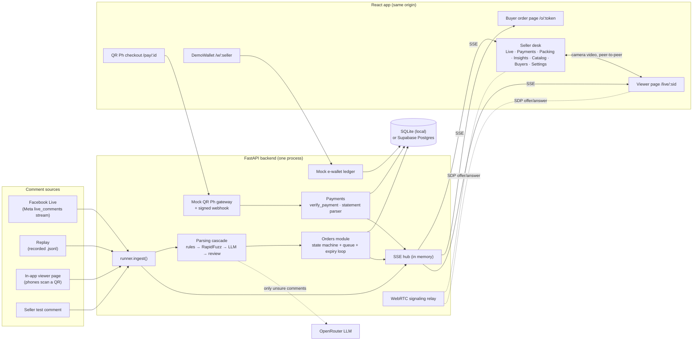
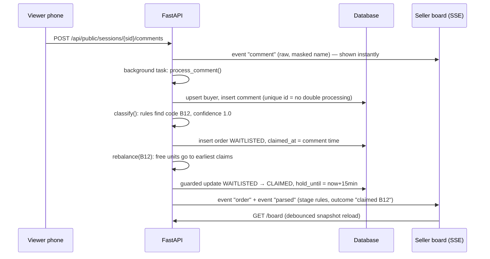

# 01 · Overview and architecture

## The one-sentence version

One FastAPI backend reads live comments from any source, turns them into orders with a rules → fuzzy → LLM cascade, keeps a fair queue per item, checks payments against the seller’s own records, and pushes every change to the React screens over Server-Sent Events.

## System diagram



**Rule of thumb for Q&A:** only the backend talks to Meta, OpenRouter and the database. The browser calls REST routes and receives changes as SSE events. The Orders module (`api/app/orders/`) is the only place an order’s status changes.

## Components

| Part | File(s) | Job |
| --- | --- | --- |
| App wiring | `api/app/main.py` | Creates tables, seeds the demo shop, starts the expiry loop, mounts `/api`, serves the built web app |
| Settings | `api/app/config.py` | Every env var with a safe default, so the demo runs with zero setup |
| Database | `api/app/schema.py`, `api/app/db.py` | 13 tables (SQLAlchemy Core); tiny query helpers; SQLite lock / Postgres pool |
| Comment sources | `api/app/sources/` | `meta_live.py` (Facebook), `replay.py` (recordings), `runner.py` (one task per live; `ingest()` for every source) |
| Parsing cascade | `api/app/pipeline/` | `rules.py`, `fuzzy.py`, `llm.py`, `cascade.py` |
| Orders | `api/app/orders/` | `states.py` (state machine), `queue.py` (claims, waitlist, confirm, expiry), `labels.py` (buyer labels) |
| Payments | `api/app/payments/` | `verify.py` (pure check), `statement.py` (CSV parser), `service.py` (glue), `gateway.py` (mock QR Ph + webhook), `wallet.py` (mock e-wallet) |
| Realtime | `api/app/hub.py`, `api/app/rtc.py` | SSE fan-out; WebRTC offer/answer relay |
| Read models | `api/app/views.py` | Exactly what each screen receives (board snapshot, buyer view, masking) |
| Routes | `api/app/routers/` | `sessions`, `catalog`, `buyer`, `payments`, `public`, `seller` |
| Web app | `web/src/` | `seller/` screens, `public/` phone pages, `components/`, `lib/` (API client, SSE hook, WebRTC) |

## What happens when someone comments “mine B12”



The raw comment is broadcast **before** parsing, and parsing runs as a background task, so a slow LLM call never stalls the comment feed.

## Repo layout

```text
api/                  FastAPI backend
  app/                main.py, config.py, db.py, schema.py, hub.py, rtc.py, views.py, auth.py, seed.py, sessions.py
    sources/          meta_live.py, replay.py, runner.py
    pipeline/         rules.py, fuzzy.py, llm.py, cascade.py
    orders/           states.py, queue.py, labels.py
    payments/         verify.py, statement.py, service.py, gateway.py, wallet.py
    routers/          sessions.py, catalog.py, buyer.py, payments.py, public.py, seller.py
  recordings/         demo_tondo_live.jsonl (Replay source)
  bench/              comments.csv (labeled Taglish), run_bench.py
  tests/              test_rules, test_verify, test_statement, test_flow
  scripts/            export_schema.py
web/                  React + Vite + TypeScript
  src/seller/         Sessions, LiveBoard, Payments, Packing, Insights, Catalog, Buyers, Settings, OrderDrawer
  src/public/         BuyerOrder, Viewer, PayQR (mock QR Ph), Wallet (DemoWallet)
  src/components/     ui, Icon, ItemThumb, QR, Modal, Toast
  src/lib/            api.ts, hooks.ts (SSE), rtc.ts (WebRTC), format.ts, publicUrl.ts, types.ts
  e2e/                flows.spec.ts (Playwright), tour.mjs (screenshot tour)
supabase/schema.sql   generated Postgres DDL + RLS
docs/                 this documentation
```

## Decisions that differ from the original plan (and why)

| Plan | Built | Why |
| --- | --- | --- |
| Supabase only, psycopg | SQLAlchemy Core; SQLite by default, Postgres by env var | The demo must run on a laptop with no accounts and no internet; the same tests pass on both (see doc 09) |
| React on Vercel + API on Render | One process serves API + built web app | One URL for phones and judges, no CORS, works on venue Wi-Fi; split deploy still supported |
| PayMongo test-mode QR (optional spike) | Mock QR Ph gateway with the same shape (intent → QR → signed `payment.paid` webhook) | No business-verified gateway account; the user asked for a clean mock. Swapping in PayMongo only touches `gateway.py` |
| GCash statement from a real seller | DemoWallet that exports a GCash-style CSV | Lets the manual flow be demoed end to end; real GCash/bank CSVs still parse (flexible columns) |
| QR live chat as a fallback | In-app live page with real camera video (WebRTC) | Judges can watch and comment from their phones, and it doesn’t depend on Meta app review |
