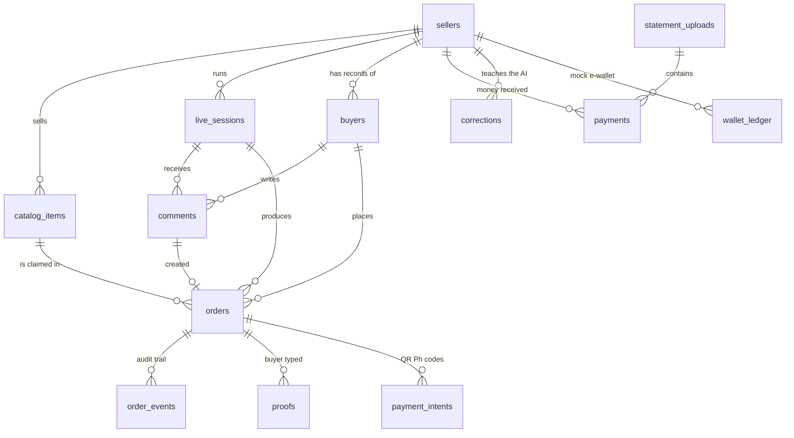

# 02 · Data model

Defined once in `api/app/schema.py` (SQLAlchemy Core). `supabase/schema.sql` is generated from it by `api/scripts/export_schema.py`. The backend creates any missing table on startup, so a fresh laptop needs no migration step.

## Rules that hold everywhere

- **Money is whole centavos** (`price_centavos`, `total_centavos`, `amount_centavos`). ₱850.00 is `85000`. No floats ever touch money; pesos are only formatted for display (`web/src/lib/format.ts → peso()`).
- **Times are stored in UTC** (`UTCDateTime` type in `schema.py` re-attaches the timezone, because SQLite drops it).
- **IDs** are UUID strings, except comments (the platform’s own comment id, so a resent Meta comment can’t be processed twice) and payment intents (`pi_…`).

## Tables

| Table | What one row is | Key columns |
| --- | --- | --- |
| `sellers` | The shop (one demo seller) | `payment_mode` (manual / instant_qr / both), wallet details shown to buyers, `hold_minutes`, `pay_window_hours`, `auto_release_gateway` |
| `catalog_items` | An item code on sale | `code` (unique per seller), `price_centavos`, `sizes[]`, `stock`, `keywords[]`, `photo_url`, `active` (soft delete when it has order history) |
| `live_sessions` | One live | `source` (meta / replay / chat), `live_video_id`, `current_item_id` (item on camera), `recent_item_ids`, `status` |
| `buyers` | A commenter, per seller | `platform_user_id` (Meta id or `chat:<device>`), counters: `claims`, `verified`, `failed_proofs`, `expired_unpaid`, `cancels`, `max_paid_centavos` |
| `comments` | One comment | `created_time` (the platform’s time; decides queue order), `parse_stage`, `parse_result`, `confidence`, `outcome`, `resolved` |
| `orders` | One claim of one item | `status`, `claimed_at`, `hold_until`, `pay_by`, `buyer_token` (128-bit private link), proof fields, `verdict` + `verdict_reasons` |
| `order_events` | One status change | `from_status`, `to_status`, `actor` (system / buyer / seller / webhook), `note` — the audit trail and the order timeline |
| `proofs` | A reference a buyer typed | **unique (seller_id, reference)** |
| `statement_uploads` | One uploaded CSV | `covers_until` (newest time the file covers) |
| `payments` | Money the seller actually received | `source` (statement / qrph), **unique (seller_id, source, reference)** |
| `corrections` | A seller fix from Needs you | `message`, `fixed` JSON; reused as LLM few-shot examples |
| `payment_intents` | A mock QR Ph code | `amount_centavos`, `status`, `expires_at`, `reference` once paid |
| `wallet_ledger` | A transfer into the seller’s mock e-wallet | `reference` (13 digits like GCash), `amount_centavos`, `sender_name` |

## Why it’s shaped this way

- **`proofs` and `payments` are separate on purpose.** A proof is what the buyer *claims*; a payment is what the seller’s statement or the gateway *says arrived*. Verification compares the two. A screenshot is never stored, so there’s nothing to forge.
- **The unique rule on `proofs (seller_id, reference)`** makes reusing one reference for two orders impossible, even if two buyers submit at the same second. The second insert fails, and the check reports “reused reference”.
- **The unique rule on `payments (seller_id, source, reference)`** makes re-uploading the same statement, or a webhook delivered twice, add nothing.
- **`statement_uploads.covers_until`** lets the system say *Pending* (“your statement is older than this payment”) instead of a false *Hold*.
- **Buyer stats are counters**, so the label (HOLD / WATCH / TRUSTED / NEW) is computed on read (`orders/labels.py`) and can never go stale.
- **The order keeps a copy of the latest proof** (`proof_reference`, …) so that even when the `proofs` insert is rejected as a duplicate, the check still knows what this buyer typed.
- **Comments keep the platform’s `created_time`.** The queue sorts by it, so a comment that took longer to parse still gets its fair place.
- **Row Level Security** is enabled on every table with no policies (see `supabase/schema.sql`): only the backend’s connection string can read data; Supabase’s public REST API returns nothing.
