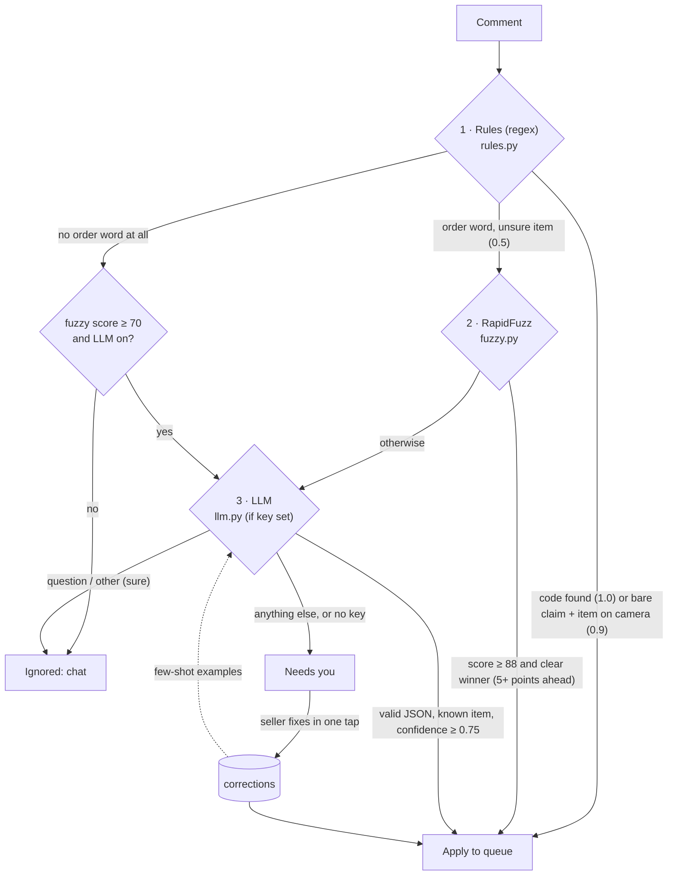

# 03 · Comment pipeline and AI

Every comment goes through three steps, cheapest first, and stops at the first one that is sure. Anything still unsure goes to **Needs you** instead of becoming a wrong order. Code: `api/app/pipeline/`.

## Step 1: rules (`rules.py`)

- `CLAIM` words: mine, mina, pa-mine, akin, sakin, kuha, kunin, pabili, grab, order, reserve.
- `CANCEL` words: cancel, pass, di na, hindi na, ayaw ko na.
- `WAITLIST` words: backup, waitlist, next po, pa-next.
- `CODE`: `B12`, `b 12`, `B-12`; only codes that exist in the catalog count.
- A lone `m` (or `mmm`) means *mine* for the item on camera.
- “mine po” with nothing but filler words left (po, ate, sis, yung, nasa camera, eto…) = the item on camera, confidence 0.9.
- Size: XS/S/L/XL/small/medium/large. A lone **M is deliberately not a size** at this step, because “m” also means “mine”. The item-aware `pick_size()` accepts M only with a hint (“medium”, “, M”, “M sana”, “M po”) and also matches the item’s own sizes like “28” or “Free size”.
- Quantity: `2pcs`, `x2`, `2x`, capped at 20.

## Step 2: RapidFuzz (`fuzzy.py`)

The comment is cleaned (claim words, sizes, quantities and filler removed) and matched with `WRatio` against every item name and keyword. Each item keeps its best score. It only settles the item when:

- the comment had a claim/waitlist word (step 1 found intent but not the item), and
- the best score is **≥ 88**, and
- it’s a **clear winner**: at least 5 points ahead of the next item. “akin yung guhit na tee” scores 90 vs 85.5 for two tees, so it goes to the LLM or review instead of guessing.

A multi-word name fully present in the comment (“blue polo”) scores at least 95.

## Step 3: the LLM (`llm.py`)

Only called for what rules and RapidFuzz couldn’t settle, and only if `OPENROUTER_API_KEY` is set.

- **Input** (JSON): the comment, the item on camera, the last 5 items shown, the top fuzzy candidates, the buyer’s recent item **codes**, and up to 10 seller corrections as examples. **Never the buyer’s name or platform id** (RA 10173).
- **Output** must parse into the `Parse` Pydantic model: `intent ∈ {claim, cancel, waitlist, question, other}`, `item_code`, `size`, `qty`, `for_name` (“para kay Ana”), `confidence`.
- **Guards:** temperature 0, JSON mode, 15 s timeout. Any HTTP error, invalid JSON, or an **item code that wasn’t offered** returns `None` → Needs you. The model can never invent an order for an item that isn’t in the catalog.
- **Few-shot learning:** every fix in Needs you is saved to `corrections`. Up to 30 are sent as-is; above 30, the 10 most similar (RapidFuzz again) are sent. No vector database needed at this size.

The AI only **reads**. Every decision that touches money or fairness (who gets the item, payment matching, release) is plain code.

## Needs you (review bucket)

The board’s right rail shows the oldest unresolved review comment with “Looks like: Claim · B7 · M”. The seller can **Approve** (applies the suggestion), **Edit** (intent, item, size, qty), or **Ignore**. Code: `fix_comment()` / `dismiss_comment()` in `cascade.py`, UI in `LiveBoard.tsx → Review`.

## Benchmark (`api/bench/`)

`bench/comments.csv` is a starter set of 69 hand-labeled Taglish comments (claims by code, by description, bare claims, cancels, waitlists, questions, chat). `run_bench.py` runs them through each setup. A comment is right when intent and item both match the label; “wrong order” is a comment that would have changed an order for the wrong item, which is the costly failure.

Measured on this machine. The first two rows are without an LLM key; the LLM rows were measured on 2026-11-08 with `anthropic/claude-haiku-5.5`:

| Setup | Right | Sent to review | Wrong order | Time per comment |
| --- | --- | --- | --- | --- |
| Rules only | 58.0% | 42.0% | **0.0%** | <0.1 ms |
| Rules + RapidFuzz | 94.2% | 5.8% | **0.0%** | 0.2 ms |
| + LLM | 95.7% | 4.3% | **0.0%** | ~180 ms (only ~1 in 10 comments calls the LLM) |
| + corrections | 95.7% | 4.3% | **0.0%** | ~220 ms |

Run it: `cd api && .venv/Scripts/python -m bench.run_bench`. With `OPENROUTER_API_KEY` set it adds the LLM rows; the corrections row uses 30 comments as examples and scores the other comments, so it never grades the examples it learned from. With a key set, the RapidFuzz row prints lower (89.9%): chat that loosely matches an item name, like “ang ganda ng trench coat!!”, is held for the LLM, and that row has the LLM switched off, so it counts as review.

Cost: an LLM call is about 400–1,200 input tokens and 50 output tokens (about $0.00006 with Haiku 5.5), so 1,000 live comments cost about $0.015 in AI. Before the final pitch the business team should grow the CSV to 100+ real comments (names removed) and re-run it.

**How to read the result:** rules alone already make zero wrong orders, they just send many comments to review. Each step after that turns review work into automatic orders without adding wrong ones. That’s the honest answer to “why AI?”.
