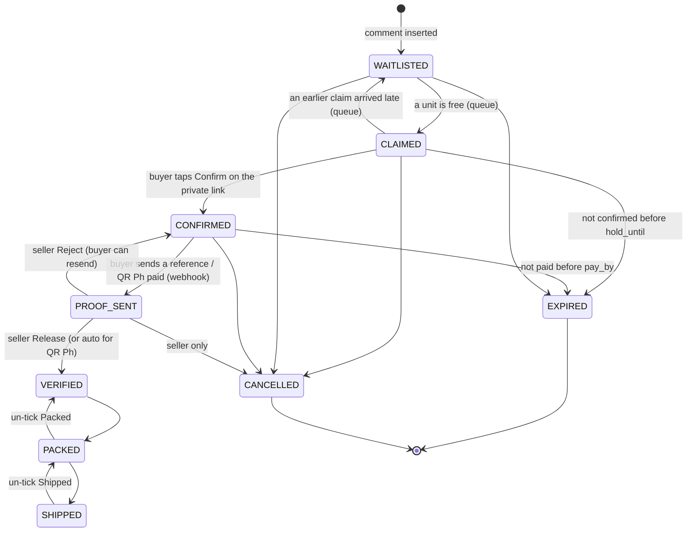

# 04 · Orders, queue and states

Code: `api/app/orders/states.py` (state machine), `api/app/orders/queue.py` (queue, confirm, expiry), `api/app/orders/labels.py` (buyer labels).

## States

`PROOF_SENT` never expires: the buyer has done their part, so only the seller can end it.

## Guarded transitions (the most important function to defend)

Every status change goes through `transition(order_id, to, actor, note, **fields)`:

1. Look up which states are allowed to move to `to` (`ALLOWED` table).
2. `UPDATE orders SET status = :to … WHERE id = :id AND status = :current` — the update only succeeds if the order is still in the state we read.
3. If it updated exactly one row, write an `order_events` row (the audit trail) and publish an SSE event. Otherwise return `None`.

So if the buyer taps Confirm at the same instant the expiry loop expires the claim, exactly one wins and the other gets `None` back. Nothing can skip a step (e.g. CLAIMED → VERIFIED) because that arrow isn’t in `ALLOWED`. On SQLite every transaction is also serialized by one asyncio lock; on Postgres the guarded `UPDATE … WHERE status = …` is atomic on its own.

## The queue rule (who gets the item)

`rebalance(item_id)` runs whenever a claim arrives, is cancelled, expires, a buyer changes quantity, or stock changes:

1. `locked` = units held by orders that are CONFIRMED or later (they keep their unit, always).
2. `free = stock − locked`.
3. Walk the CLAIMED + WAITLISTED orders **sorted by comment time** (the platform’s timestamp, not when we processed it). Give each one its quantity while units remain; once one doesn’t fit, everyone after waits (strict first-come-first-served).
4. Move each order to CLAIMED (with a fresh `hold_until`) or WAITLISTED as needed, through `transition()`.

Why comment time: the LLM may take a second longer on a messy comment. Sorting by the comment’s own timestamp means “ako nauna!” (“I was first!”) is settled by the platform’s clock, not by our processing speed. It never takes a unit away from a confirmed buyer.

New claims are inserted as WAITLISTED and `rebalance` promotes them, so there is exactly one place that decides who holds a unit.

## Other rules

- **Duplicates:** a second “mine B12” from a buyer who already has an open order for B12 in this live is ignored (“already in line for B12”).
- **Cancel in comments** (“cancel B12”, or just “cancel” = their latest open order) works for CLAIMED, WAITLISTED and CONFIRMED.
- **Confirm** (`queue.confirm`): the buyer may fix size (must be one of the item’s sizes) and quantity (can’t exceed what’s free). It sets `pay_by = now + pay_window_hours`, and re-runs `rebalance` in case a smaller quantity freed a unit.
- **Expiry loop** (`expiry_loop`, every 10 s by default): CLAIMED past `hold_until` and CONFIRMED past `pay_by` become EXPIRED, the buyer’s `expired_unpaid` counter goes up (for unpaid), and the item is rebalanced so the next buyer is promoted. It also expires stale QR Ph codes.
- Defaults: 15 minutes to confirm, 24 hours to pay. The seller changes both in Settings.

## Buyer labels (`labels.py`)

Computed on read from counters, never stored:

| Label | Rule |
| --- | --- |
| HOLD | at least 1 failed payment check, or 3+ orders expired unpaid |
| WATCH | 3+ claims and at least a third of them cancelled or expired |
| TRUSTED | 3+ verified payments and no failed checks |
| NEW | everything else |

Labels stay inside one seller’s shop. There is no shared blacklist between sellers (privacy and defamation risk).
