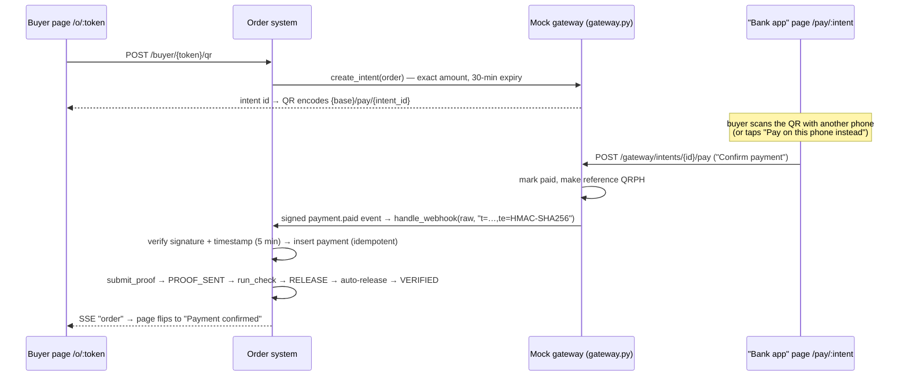

# 05 · Payments and the mock QR Ph

The system never reads a screenshot. It compares **what the buyer says they paid** (a reference) with **what the seller actually received** (her statement, or the gateway). Code: `api/app/payments/`.

## Two ways to pay, one check

| | Manual (default in the plan) | Instant QR (QR Ph) |
| --- | --- | --- |
| Buyer does | Pays the seller’s e-wallet outside the app, checks it in their own app, types the reference | Scans the order’s QR Ph code with any bank/e-wallet app and approves |
| Money evidence | Seller uploads her statement CSV | Gateway sends a signed `payment.paid` webhook |
| Writes to | `payments` (source `statement`) | `payments` (source `qrph`) |
| Result | Release / Hold / Pending; **seller taps Release** | Release → **auto-released** to VERIFIED (setting `auto_release_gateway`), because the gateway already confirmed the money |

The seller picks Manual, Instant QR or Both in **Settings → Payments**. With Both, the buyer’s page shows two tabs.

## `verify_payment()` — the pure check (`verify.py`)

Everything it needs is passed in, nothing is read from the database inside, so it is easy to test and to explain. It runs **every** check and returns **every** reason found, so the seller sees all problems at once.

| Check | Outcome if it fails |
| --- | --- |
| A reference was given | HOLD “missing reference” |
| The reference isn’t already used on another order | HOLD “reused reference” |
| The reference is in the statement | **PENDING** “waiting for a newer statement” if the statement is older than the proof; otherwise HOLD “reference not in your statement” |
| Amount received = order total | HOLD “amount mismatch: paid ₱390.00, order ₱780.00” |
| Payment isn’t older than the order (5 min grace) | HOLD “payment is older than the order” (an old real transfer reused) |
| Order isn’t over 3× this buyer’s biggest paid order | HOLD “unusual size” (soft check, for new big spenders) |
| All good | RELEASE “reference found, amount matches” |

A near match (RapidFuzz ratio ≥ 85 against unmatched statement references) is shown to the seller as a suggestion only (“close match in your statement: …”). It is never accepted automatically.

**Pending vs Hold** is what keeps honest buyers from being flagged: if the statement was exported before the buyer paid, the reference *can’t* be in it yet, so the order waits. `statement_uploads.covers_until` is the newest payment time in the file, or the file’s own “as of” time if the export prints one (DemoWallet does).

## Statement upload (`statement.py`, `service.upload_statement`)

- Columns are found by name, so GCash, Maya and bank exports all work: reference (`Reference No.`, `Ref No`, `Transaction ID`…), amount (`Amount`, `Credit`…), time (`Date and Time`, `Transaction Date`…). Title rows above the header and total rows at the bottom are skipped.
- Only money **in** is kept. References are cleaned (`1234 567-890` → `1234567890`). Amounts become centavos with `Decimal` (no float rounding). Times without a timezone are read as Asia/Manila.
- Re-uploading the same file adds nothing (unique `seller_id, source, reference`).
- After the upload, every PROOF_SENT order is re-checked: this is the live “flip” in the demo.

## Seller actions (Payments screen)

- **Release** → VERIFIED; the buyer’s `verified` and `max_paid_centavos` go up.
- **Release all green** → releases every order whose check says RELEASE.
- **Reject** → back to CONFIRMED so the buyer can resend; counts as a failed check (buyer label HOLD). The reason stays on the seller’s screen; the buyer only sees a neutral note.
- **Ask buyer** → a note on the buyer’s page asking them to re-check the reference.
- **Release anyway** for a Hold, when the seller verified it herself.

## The mock QR Ph gateway (“MockPay”, `gateway.py`)

The brief asked for payment verification automation as a mock: a page with a payment confirmation button, opened through a QR that mimics QR Ph. It is built to have **the same shape as a real gateway** (PayMongo QR Ph), so the order system can’t tell the difference:

Details worth knowing in Q&A:

- **Signature:** header `X-MockPay-Signature: t=<unix time>,te=<hex HMAC-SHA256 of "t." + raw body>` with `GATEWAY_WEBHOOK_SECRET`. Same scheme as PayMongo’s `Paymongo-Signature`. Old timestamps (> 5 min) are rejected, so a captured event can’t be replayed later. The same handler is exposed at `POST /api/webhooks/qrph` for a real gateway to call.
- **Idempotent:** a duplicate delivery hits the unique `payments` rule and returns `{"duplicate": true}`; double-tapping “Confirm payment” returns the already-paid intent.
- **Exact amount:** the intent is created for the order’s total; if the buyer changes quantity, a new intent is made.
- **Expiry:** codes expire after 30 minutes (expiry loop); the page offers “Get a new QR”. Paying an expired code or an order that’s no longer CONFIRMED is refused with a clear message.
- **Swapping in PayMongo:** replace `create_intent()` with PayMongo’s QR Ph API call (put `order_id` in metadata) and point PayMongo’s webhook at `/api/webhooks/qrph` with their secret and header name. Nothing in orders or verification changes.

## DemoWallet (`wallet.py`, `/w/:sellerId`)

Stands in for the seller’s GCash account so the Manual flow can be demoed end to end: the buyer “sends money”, gets a 13-digit reference (GCash style) and types it on the order page. On Payments, **Get DemoWallet statement** downloads a GCash-style CSV that is uploaded like a real export. The order system never reads the wallet table directly; it learns about the money only through the uploaded statement, exactly like with a real e-wallet.
