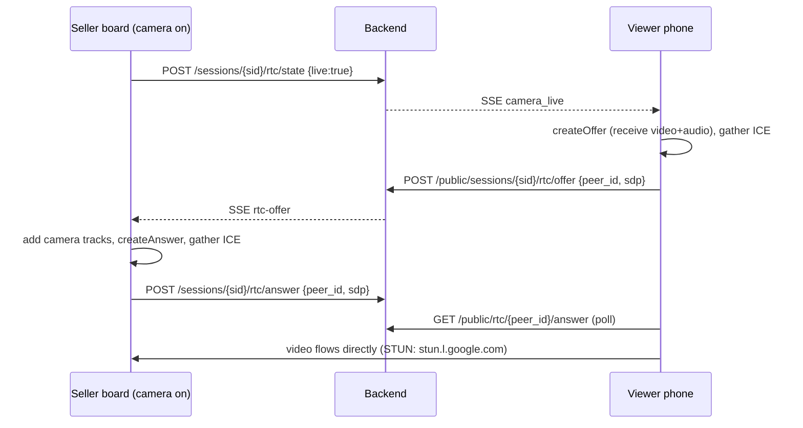

# 06 · Realtime updates, comment sources and live video

## Server-Sent Events (`api/app/hub.py`)

One in-memory hub fans events out to subscribers by key:

| Key | Who listens | Events |
| --- | --- | --- |
| `session:{id}` | Seller live board | `comment` (raw), `parsed`, `order`, `verdict`, `camera`, `session`, `rtc-offer`, `replay_done` |
| `seller:{id}` | Payments, Packing, Insights, sidebar counts | `order`, `verdict`, `payment` |
| `viewer:{id}` | Public viewer page | `comment` (masked names), `parsed` (outcome only), `camera`, `camera_live`, `session` |
| `order:{token}` | One buyer’s order page | `order` |

The browser loads a snapshot once, then applies events. `useEventStream()` (`web/src/lib/hooks.ts`) reloads the snapshot on every (re)connect, so a dropped connection never loses anything. Bursts are debounced into one reload. Each stream sends a `: ping` every 15 s so proxies keep it open, and a frozen tab can never slow the live: each subscriber has a bounded queue and is skipped when full.

Why SSE and not WebSockets: data flows one way (server → screen), SSE reconnects by itself, and it works through ordinary HTTP. Writes go through normal REST routes.

The seller key is passed as `?key=` on seller streams because `EventSource` can’t send headers.

## Comment sources (`api/app/sources/`)

All sources call the same `runner.ingest(session_id, comment)`, so nothing after that knows where a comment came from.

| Source | How | When to use |
| --- | --- | --- |
| **Facebook Live** (`meta_live.py`) | Streams `https://streaming-graph.facebook.com/{live_video_id}/live_comments` with the Page token (backend only). Errors show on the board. | Real lives. Needs a Page token and, for viewers without a role on the Meta app, App Review. |
| **Live here** (in-app) | Viewers scan the QR, open `/live/:sid`, enter a name and comment. `POST /api/public/sessions/{sid}/comments`, max 1 comment/second per device. | The demo’s wow moment: judges comment from their own phones. |
| **Replay** (`replay.py`) | Plays `api/recordings/*.jsonl` with the original gaps, 1×–4×. Recordings can include `{"type":"camera"}` rows to put items on camera. | Bad Wi-Fi fallback, rehearsals. Export any live with **Export** on the Lives page. |
| **Test comment** | “+ Type a test comment” on the board. | Rehearsing a specific comment. |

Comment ids are unique per source (Meta’s id, `chat:<uuid>`, `<session>:<run>:<row>` for replays) and inserted before parsing, so the same comment is never processed twice.

## Live video (`web/src/lib/rtc.ts`, `api/app/rtc.py`)

The seller’s camera streams **peer-to-peer** from the seller’s browser to each viewer’s phone with WebRTC. The backend never touches the video; it only relays the connection setup:

- Non-trickle ICE (each side waits up to 2.5 s for candidates) keeps signaling to one round trip over plain REST + SSE.
- The seller can switch cameras and mute the mic; switching replaces tracks on existing connections.
- Works on the same Wi-Fi and through most home/mobile NATs via STUN. Networks that block peer-to-peer (strict corporate/venue firewalls, symmetric NAT) would need a TURN server; viewers can still comment, and the page falls back to the item card or a Facebook video embed.
- The camera needs a secure context: open the seller board on `http://localhost` (or HTTPS). Viewers only *receive* video, which works on plain HTTP over the LAN.
- If the session has a Facebook video link, viewers see the Facebook embed whenever the in-app camera is off.

## Where QR codes point (`web/src/lib/publicUrl.ts`)

QR codes must open on a phone, so `localhost` is useless in them. Order: `PUBLIC_WEB_URL` (backend env) → `VITE_PUBLIC_URL` → the page’s own origin if it isn’t localhost → the laptop’s LAN IP from `GET /api/net`. Links clicked on the same device use relative paths.
